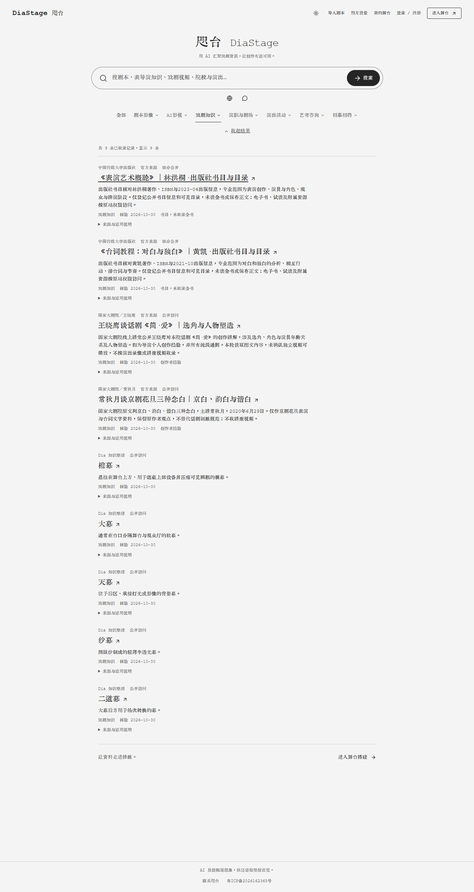
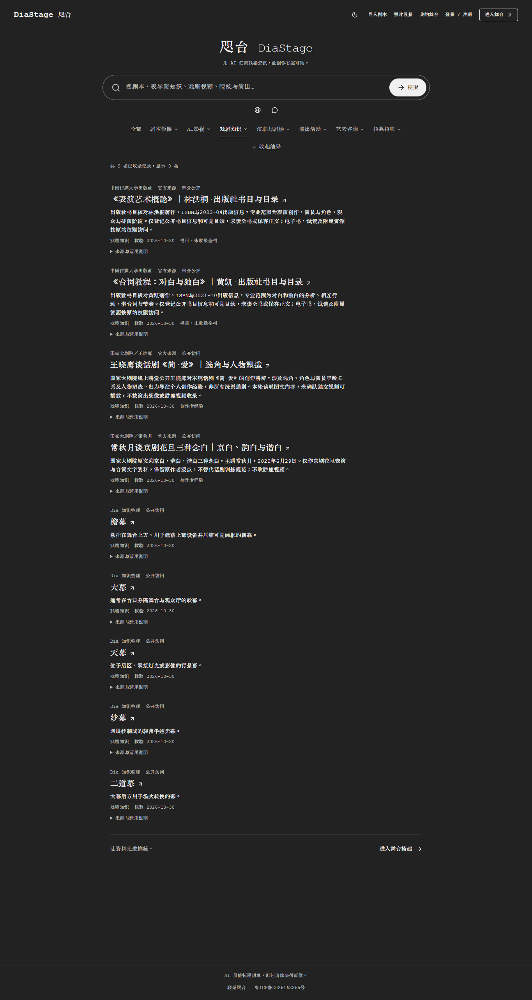

# Windows 接续与首页浏览器验收 · 2026-10-31

工作分支 `codex/path9-desktop-ui`；运行源码为 `5c05cd1002890377592989851b0ae32479bf0796`。本轮先阅读当天交接、DiaMotif 内容审核和最新待办，完成接续队列的免费首页验收及旧收录指引收尾。以下是本机限定范围的证据，不是公网发布、真实用户研究或模型效果验收。

## 同步、构建与本机启动

- 旧目录停在 `2d0d9d4`，隐私页和使用说明页各有未提交修改，均保留原样；使用独立目录接收新分支。
- 本机 GitHub smart-HTTP 连接超时。改用官方 GitHub API/raw 下载与旧仓库只读对象复用，校验2548个文件、2527个唯一blob及整棵tree，精确恢复原始提交。当前是单提交浅副本；没有伪造提交或改写远端。`git fsck --full --strict` 通过，初始工作树干净。此结果不表示完整Git历史已拉取。
- Windows、Node 24.19.0、Bun 1.3.14；`bun install --frozen-lockfile` 成功，771个依赖安装，锁文件未改。
- `node node_modules/turbo/bin/turbo run build --filter=editor --env-mode=loose --log-order=stream`：6/6任务、0缓存、39.018秒；Next编译、TypeScript及20/20页生成通过。构建使用隔离数据目录。
- 用Node启动生产构建，监听本机 `127.0.0.1:4318`。首页HTTP 200，`/api/health` 为ok，version与上述完整SHA一致，instanceId为`path9-windows-20261031`。已请求Codex打开首页。
- 本机启动脚本、日志、备份和数据库留在私有目录，不入Git；没有复制另一电脑的私有配置。此次运行未配置模型Key和受邀名单，认证邮件关闭，免费目录和手动舞台可用。它不代表另一台电脑或腾讯云已启用相同配置。

## 免费浏览器验收

使用本机Chrome、独立无登录的Playwright上下文，桌面视口1365×900，实际导航、点击与键盘交互。应用请求保持免费；检测到付费搜索或其他修改API时测试会阻止并报错。本次没有这类请求，`pageerror=0`。测试是浏览器自动操作，未冒充用户人工操作。

| 检查 | 结果及边界 |
| --- | --- |
| 免费目录API | 总62、知识9、完整剧本0、完整演出0；`aiStatus=disabled`、`answer=null` |
| 知识列表 | 页面实际渲染9条；出版社书目明确未收全书，不当作完整文本 |
| 分类范围 | 剧本影像菜单不再出现研究纪录、专业讲座、直播回放、片段、采访、独白；AI中“创作与教程”只有一个，旧分开的两方向消失 |
| 菜单与结果 | Esc关闭下拉并归还触发按钮焦点；点外侧关闭；结果可收起/展开 |
| 日夜显示 | 两种主题均有截图；1365px视口无横向溢出；截图已目视核对 |
| 来源跳转 | 点击首条《表演艺术概论》书目标题，打开与登记一致的出版社新标签URL；只证明导航，没有据此声称外部正文、完整书籍或播放器已核验 |
| 旧链接 | `category=ai-screen&topic=ai-tools` 回退类别浏览，显示7条AI创作参考；没有应用错误提示 |
| 纠错检索 | 免费URL检索“谐白”返回已确认的常秋月条目 |
| 登录入口 | 首页登录链接可达邮箱/密码表单；未提交登录、注册或找回请求，不记真实账号登录闭环通过 |

首次脚本把Next的无障碍路由播报器也计入`role=alert`，导致测试断言失败；随后将断言限定为实际应用错误提示，并等待7条AI记录出现，完整复跑通过。没有为通过测试修改产品源码。详见[浏览器结果JSON](evidence/windows-home-20261031/browser-report.json)。

| 日场 | 夜场 |
| --- | --- |
|  |  |

## 收录指引与离线验证

仅修正三处旧文档/候选指引：`references/search-classification.md`、`references/pending-video-review-20261030.md`、`knowledge/pending-sources.json`。当前方向数为63，旧174/47/88等计数明确为历史；原8条视频候选批次现在保留7个候选、2条文字资料待审。旧专访、讲座视频及产品宣发的推进建议退出当前指引，不以更换标签重新发布。

候选的ID、标题、URL、状态与原核验事实保持不变；8已处理+13现存记录+2政策移除=原23条。当前公开各类合计62；25条地域内待审、13条区域外暂缓和140个概念待审维持原状态。本轮没有新增正式资料，也未改解析器、Camera或舞台逻辑。

- `bun --no-env-file test lib/diamotif-search lib/stage-theme.test.ts`：11文件、198通过、0失败、2422次断言。AI相关隔离子进程使用合成Key与模拟网络，不是实际千问结果；与此前195项范围不同，不相加统计。
- `git diff --check`、JSON解析、候选资料字段深比较及计数核验通过。
- Biome配置未包含DiaMotif目录，指定JSON检查实际处理0文件，不能写成Biome通过。本轮未改受Biome检查的应用源码。

## 数据保护与剩余工作

启动前通过SQLite backup API备份本机数据并验证完整性，启动复用原本机数据。验收后与备份逐行比较：2个scenes、2条scene_revisions、0条scene_events全部相同，原user/account数据及auth.secret一致，场景库和账号库integrity_check均为ok。未创建验收剧目、修改正式场景或上传私有数据。旧目录两处未提交修改的SHA-256也保持不变。

下一步从18个入口核真实完整正文/正片与合法访问，逐条复审25条地域内资料及140个概念；差异须先通报，确认前不发布。真实千问引用、预告时态、完整正文/播放器及舞台完整闭环仍待验，不能用本轮免费页面与离线结果替代。本机未找到原heartbeat配置，未创建重复自动化，也没有下一次执行成功的证据。

没有新增付费模型调用、测试邮件、生产服务切换、main合并或腾讯云部署。
