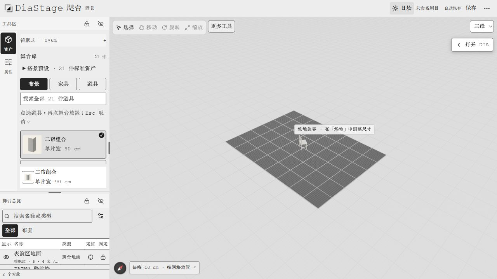
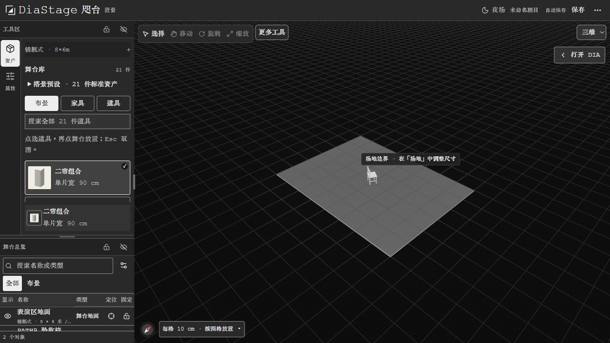

# PATH9-V2 交接与验收 · 2026-10-28

PATH9-V2：按清单冲电脑≥9；字体沿用个性栈；移动暂缓。

**这是跨电脑源码检查点，不是总闸通过或上线公告。当前 12 项 done、3 项待最终验收，未报告 ≥9。** 用户要求先同步 GitHub，晚间在另一台电脑继续；保留失败证据，不用源码测试替代浏览器验收。

## 从这里继续

- 仓库：`Canoeliu917/DiaStage`；工作分支：`codex/path9-desktop-ui`；[Draft PR #4](https://github.com/Canoeliu917/DiaStage/pull/4)。PR 基线为 `codex/private-scene-accounts-v01-20261014`，不要把基线当作最新桌面版本。
- 本轮起点：`c2691e6f506fd7a3e006c312f879d65c9ebfa132`。
- 首批实现及已构建版本：`e7264823e8c3badcd4bd6f00204986c47b65c74e`。
- 最新源码：`74cf3f7fe72f3114892fb2c72716e17c991d6bef`，包含 Composer、网格和 SSE 修正；自动回归通过，**尚未重新完整构建或浏览器复测**。
- 输入「继续工作」时，先核对分支与未提交修改，读取本文件和 [15 项 JSON](PATH9_V2_CODEX.json)。不要重置已有工作，不从旧照片任务直接开始。

下一步按顺序：

1. 在接手电脑检查 Node（最低 22.13，本机使用 Node 24）和 Bun 1.3.14，准备独立本地数据及稳定认证配置，完成最新源码构建与启动，核对运行版本。
2. 多开编辑标签验证：后台释放实时连接，切回补收更新；保存显示「本机已保存 · 已同步」，刷新后位置仍保留；未同步修改不能被远端覆盖。
3. 同一轮确认新 Composer 与夜场网格，并保存最新日夜截图。旧截图只能证明 `e7264823`。
4. 重新进行有记录、无讲解的代理或真实生手五分钟「打开→放景→调整→保存」，记录首次失败和复测版本，重新评估六维。只有 15 项全 done 且总闸通过才报告 ≥9。
5. PATH9-V2 收尾后回到照片自动摆位及其他 [上线待办](../diastage-release-todo.md)。

另一台电脑不会继承本机 `127.0.0.1:4318`、浏览器登录、剧目数据库、私有照片、密钥或 `outputs/start-diastage-browser-check.ps1`。这些未上传 GitHub。本机脚本仍固定旧的已构建源码，重新使用前须审阅最新源码并更新校验基线；不能假定复制命令就能在新电脑运行。源码同步不等于部署正式网站。

## 本轮修改

- 字体硬锁 Courier New / 汇文明朝 / 思源黑体，修复覆盖主字体的样式；保留本地字体，汇文明朝按需加载。
- 电脑正文与输入回调 14px / 1.5；控件最小 32px，工具轨至少 40px，道具卡 72px，缩略图 48px，仍为 21 件。
- 首次电脑访问默认收起 DIA，已有展开偏好保留；顶栏仅主题、保存和溢出入口，备份/版本/历史等收入「···」。工具轨隐藏可见快捷键字母。
- 夜场同步压暗三维背景、天空及地面；最后一批进一步降低网格亮度，并让远处网格淡出。
- 三张任务卡只预填并聚焦，不自动发送；方案有三级来源脚注，预演后采用，可取消。
- Composer 固定输入与底部操作行，附件左、发送/停止右；无附件不常驻说明，恢复提示精简；失败保留草稿。
- 三步引导支持 Esc/知道了关闭并记忆；有道具且显式保存成功后收起。减少动态同时覆盖界面与三维主题过渡。
- 保存超时调查发现后台编辑页长期占用 SSE 连接。修正为隐藏时关闭、重新可见时按 **eventId** 游标续订；保留版本冲突、本机修改、素材加载及迟到响应保护。未调大保存超时来掩盖问题。

## 逐项状态

| ID | 状态 | 证据及边界 |
| --- | --- | --- |
| FONT1 | done | 品牌字体回归；计算样式链含 Courier New、huiwenMincho、sourceHanSans，无 Inter 主栈 |
| N1 | todo | 首批真实暗舞台截图通过；最后一批网格淡化已改，待最新构建确认 |
| T1 | done | 浏览器正文 14px / 21px；caption 12px，控件规则最小 32px |
| L1 | done | 首访/已有偏好组件回归；收栏布局宽 998.4/1280px≈78%，已有偏好仍可展开 |
| L2 | done | 日夜、保存、··· 三个顶栏入口；备份与版本可打开，Esc 关闭并归还焦点 |
| F1 | done | 默认工具轨无可见 V/G/T/R 字母，实际快捷键及说明保留 |
| C1 | done | 浏览器卡片 72px、缩略图 48×48px；面板显示 21 件 |
| AI1 | done | 三卡逐个点击，中文草稿及输入焦点确认，未自动提交 |
| AI2 | done | 来源脚注 SSR 回归；Ghost/取消/迟到响应回归不写正式节点；非剧本文字不误称剧本证据。真实模型质量不在此项 |
| AI3 | todo | 发送/停止、失败留稿回归通过；最后一批 Composer 重排尚待浏览器确认 |
| S1 | done | 边框及背景弱化，hover/focus 恢复；未用整体透明度降低正文对比 |
| S2 | done | 引导 Esc/按钮关闭、持久化和显式保存后关闭测试；失败/空舞台不误标完成 |
| H1 | done | 用户把 Windows 动画由开改关；浏览器 matches=true，面板过渡 0s；已提醒恢复原设置，未假定用户已恢复 |
| G1 | done | 用户点按日夜、···、打开/收起 DIA 后确认「文字清楚，点按无明显误点」；不代表触屏通过 |
| GATE | todo | 首次代理测试保存超时；最新构建、复测、最终截图及重新评分待完成 |

## 实测与自动验证

首批 `e7264823` 完整生产构建成功：6 项任务通过（3 项缓存），约 1 分 09 秒，Next Ready。浏览器实际视口 1280×720，无横向溢出；收栏舞台约占宽 78%，展开 DIA 的既有偏好约占 56%。后者不冒充首次访问默认值；首次默认由组件回归覆盖。

自动验证按分组记录，存在重合，不相加冒充唯一测试总数：

- 初版导航、保存、DIA 偏好、字体/主题：7 项、113 次断言通过；AI/引导相关 7 文件 30 项、383 次断言通过。
- 最新 Composer：相关 5 文件 24 项、270 次断言通过；CSS 解析通过。
- 最新 SSE：先新增回归并在旧实现复现失败，修正后 SceneLoader 与三组 autosave 共 4 文件 16 项通过。覆盖初始隐藏、切后台关闭、前台游标补收、重复可见不重复连接、旧源迟到事件、未同步修改及卸载清理。
- 最后修改后的应用与 editor 类型检查、`git diff --check` 通过。没有把这些结果写成完整应用重建或真实浏览器保存通过。

## 首次代理生手记录（未通过）

独立代理未读实现说明，从首页开始，2026-10-28 **18:00:15–18:03:24 北京时间**，3 分 09 秒结束，并非真实人类首访：

- 点亮舞台→我的剧目→新建默认 8×6 米舞台；18:00:55 进入。
- 道具→一号台块→点击舞台；18:01:19 显示已落位。
- 从对象列表进入属性，向右转 30°，将台右位置改为 −200cm。
- 自动保存出现 `signal timed out`；重试及顶部保存后错误仍在。顶部的本机保存不当作同步成功，未判完整五分钟通过。
- 服务健康只读检查正常，现场有六条同源 Established 连接；源码中每个编辑页的 SSE 原本长期保持。后续数据库元数据已有新版本，说明某次晚到保存成功，**不改写首测失败**；新生命周期修正仍须浏览器复测。

## 评分与截图

以下是**首批四图的独立主观评分**，不是修正后最终分，也不等于真实用户研究。最终重评留待最新构建确认。

| 电脑维度 | 首轮参考分 | 原始权重 | 归一化权重 |
| --- | ---: | ---: | ---: |
| layout | 8.8 | 0.18 | 0.204545 |
| color | 8.5 | 0.16 | 0.181818 |
| nav | 9.0 | 0.14 | 0.159091 |
| empty | 9.0 | 0.14 | 0.159091 |
| input | 8.3 | 0.12 | 0.136364 |
| tools | 9.0 | 0.14 | 0.159091 |

电脑六维加权为 **8.77**（原权重加权和 / 0.88）；mobile 不计。empty/tools 仅为可见部分评分，初访引导、完整键盘路径与审阅态有测试或缺失视觉证据，不推断它们全部完成。两处视觉修正已落源码，暂不凭修改意图上调分数。

以下全部为首批 `e7264823` 的隔离测试剧目截图，不含用户照片或原剧目：

| 日场 | 夜场 |
| --- | --- |
|  |  |

[首批 DIA 展开](evidence/v2-desktop-night-expanded.jpg) · [溢出菜单](evidence/v2-overflow-menu.jpg) · [代理首测失败现场](evidence/v2-proxy-novice.jpg)。减少动态实测发生在此轮日夜操作中，以系统确认与实际 matchMedia/计算过渡值为依据，静态图本身不证明动画时长。

## 待确定与范围

本轮无需用户再选择字体、端侧范围或确认已有点按结论。待完成的是上述工程验收，不能以用户点击通过替代保存复测。正式部署窗口、数据保留/删除流程及后续真实模型比较等决定仍见[发布待决事项](../diastage-release-decisions.md)，本次未新增或代替决定。

手机、平板、投影、排演、复台、语音继续暂缓；本轮未改模型/API 内核、未增加模型费用、未发测试邮件、未切换生产。用户授权的阶段完成通知单独发送，不属于网站邮件服务验收。
