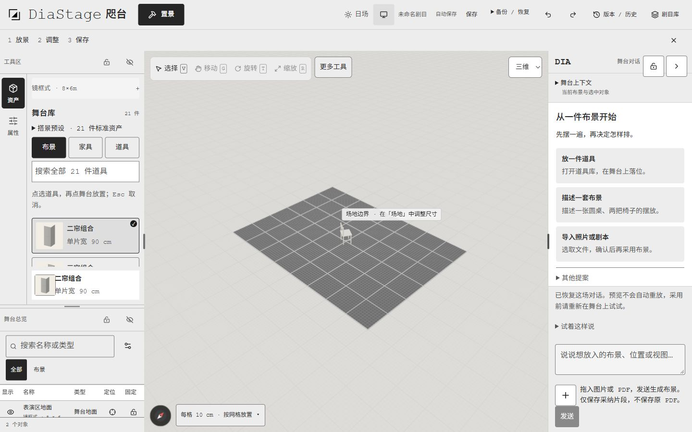
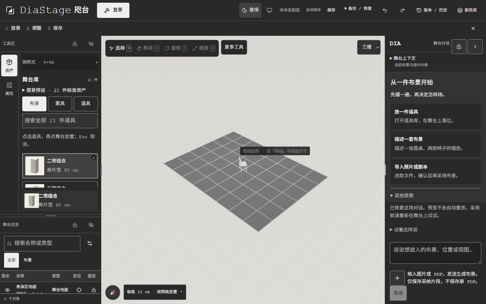

# 电脑端置景验收 · 2026-10-28

本轮仅电脑网页。用户再次确认手机、平板、投影与复台暂缓；复台、排演和语音入口保持隐藏。原附件里的生手流程已按确认改为「打开 → 放景 → 调整 → 保存」。

**当前 18 项 done、5 项待完成或验收、2 项暂缓；没有报告 ≥9.0。** C1、D2、F2 的功能已完成，但真实生手指认、复述和首次落位未测；G1 按用户最新要求改为紧凑鼠标控件，误点人工验收待做；H1 已实现减少动态规则，尚未在操作系统启用后实测。G2/G3 为 deferred，不冒充 done。计分表保留原始基线，未对本轮重新评分。

执行清单：[JSON](PATH9_CODEX.json) · [逐项说明](PATH9_CODEX.md)。最新紧凑版源码：`5cd2ac167fbae6b2654545bd35e47c3bad614a64`；[紧凑版验证与日夜截图](compact-desktop.md)。

用户最新要求收窄全站选项留白并相应缩小字体，替代原 B3 的 14–15px 与 G1 的统一 44px 目标。下方保留此前 `43c4cf5` 的功能验收记录和旧截图；新尺寸以紧凑版记录为准。

## 浏览器结果

- 桌面 1440×900：舞台 840px，宽度占 58.3%；1280×800：舞台 716.8125px，占 56.0%，页面未横向溢出。
- 日／夜主题与跟随系统可用，日场输入框和更多工具文字可读；夜场面板为 `#292929`，不是纯黑。
- 正文计算字体为 Courier New + sourceHanSans，14px，行高 23.1px；输入框保留 16px。
- 道具分类实际为布景 6 / 家具 10 / 道具 5，共 21 件。模型和两档缩略图分别为 21 / 21 / 21 个。
- 独立验收场景单击硬椅、点击舞台落位、改名为「PATH9 验收椅」、旋转、保存、刷新后保留。Esc 取消圆桌预览后仍为地面 + 一把椅子，没有新增道具。高级尺寸入口会展开外层「更多调整」。
- 原用户照片场景仅打开观察；操作验证在新建的本机验收场景进行。本轮未发送邮件或发起真实模型调用。

以上为代理操作的功能验收，不能替代真实生手五分钟测试。测量见 [measurements.json](evidence/measurements.json)。

| 电脑日场 | 电脑夜场 |
| --- | --- |
|  |  |

## 对比度

WebAIM 页面截图保留色值、比值和 AA 判定。控件色只用于控件边框，不按正文阈值评估。

| 用途 | 色值 | 比值 | 证据 |
| --- | --- | --- | --- |
| 日场次要正文 | `#555555 / #EDEDED` | 6.36:1 | [截图](evidence/webaim-day-text.jpg) |
| 夜场次要正文 | `#BEBEBE / #333333` | 6.79:1 | [截图](evidence/webaim-night-text.jpg) |
| 日场必要控件 | `#7C7C7C / #EDEDED` | 3.56:1 | [截图](evidence/webaim-day-control.jpg) |
| 夜场必要控件 | `#939393 / #414141` | 3.32:1 | [截图](evidence/webaim-night-control.jpg) |

## 自动化验证

- 单帘删除、21 资产、照片／几何／语言与空间集成：200 个唯一测试通过。另补 Esc 后提示清除：相关 8 项通过。
- 主题与知识目录：100 项通过。主题实际继承色另经浏览器检查，避免仅凭 token 测试放行。
- 首访／输入／审阅与失败路径：13 项通过，含 `stage-first-visit.test.tsx`、`command-input.test.ts`、`plan-review.test.tsx`、`scope-reduction.test.ts`、`open-dialogue.test.ts`。
- `conversation-controller.test.ts`：14 项通过，覆盖生成中取消、晚到响应、重载草稿与场景隔离。
- 保存／导航、桌面侧栏收起与调整大小回归通过；应用类型检查、CSS 解析通过；本机生产构建成功并进入 Ready。

取消／拒绝测试断言正式节点不变；模型故障测试覆盖 503、500、429、离线、坏 JSON 和无效响应，草稿可重试。测试计数分批记录，不能简单相加当成去重后的总数。

## 单帘处理

按用户明确要求删除 `SCN-FLAT-090` 注册项、GLB、两档缩略图及知识推荐。二连、三联的围合计算使用自己的几何数据；通用「景片／景墙」仍能指代现有折叠、门窗资产。

历史场景记录不删除、不自动替换；旧模型缺失时沿用既有错误占位，属性提示「模型资源缺失，原台位已保留」。生产目录不再预载单帘；不声称清除了用户所有历史浏览器缓存。

## 尚待完成

1. 真实首次使用者，无讲解，在五分钟内完成打开、放一件道具、调整、保存，并能指认当前工作区、复述三步。
2. 操作系统开启「减少动态」后的实际切换检查。
3. 人工检查紧凑鼠标控件的易读性与误点情况；不再追求所有电脑控件统一 44px。
4. 手机、平板、投影、复台等待用户后续重新纳入范围。原 25 项全部 done 门槛因此仍未满足。

GitHub 使用草稿 PR 保存本轮成果，未合并、未切换线上应用。
