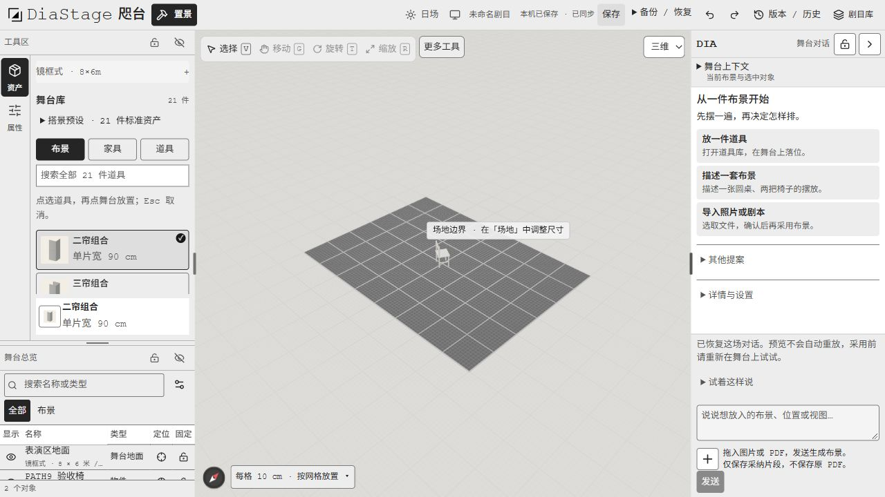
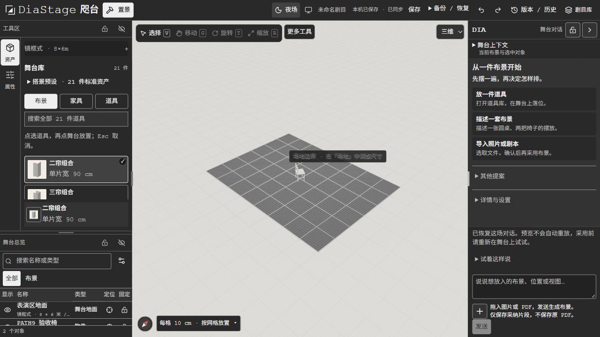

# 紧凑电脑界面 · 2026-10-28

用户要求减少整个网站选项留白，并相应缩小字体。本轮只调整首页、剧目库、工作室的字级、控件和间距；保留置景主线、21 件标准道具、原场景数据和三维比例。手机、平板、投影、复台仍暂缓。

验证源码：`5cd2ac167fbae6b2654545bd35e47c3bad614a64`。紧凑规则限定鼠标设备 `hover: hover` / `pointer: fine`，包含 Codex 内置浏览器的窄窗口。未使用全页缩放。

## 尺寸与操作检查

1280×720 本机浏览器生产构建实测；独立验收场景仅含地面与 PATH9 验收椅。图片不包含用户照片场景。

| 项目 | 最终测量 |
| --- | --- |
| 正文、输入框 | 13px / 18.85px，Courier New + sourceHanSans |
| 主舞台宽度 | 716.8125px，占 56.0% |
| 页面宽度 | 1280px，无横向溢出 |
| 侧栏标题 | 36px |
| 道具卡片 | 57.94px 高，6px 内距 |
| 舞台总览行 | 36.20px 高 |
| Dia 标题 | 40px 高 |
| Dia 任务卡 | 48.99px 高 |
| 输入框 | 52px 高，6px 内距 |
| 附件按钮 | 32×32px |
| 剧目库新建入口 | 32px 高，13px 字，4px / 10px 内距；深色字配浅色背景 |

首页建台表单在紧凑版中可见，输入框为 13px / 32px；剧目库卡片上下内距降至 20px，封面内距 8px。侧栏收起后标题行与网格同为 36px，没有遗留空行。更多工具弹层在视口内。实际窄窗口 728px 下也已检查紧凑规则与横向溢出。

最终版点击独立场景「保存」，状态变为「本机已保存 · 已同步」。本次不改场景内容，未调用付费 AI、未发送邮件、未切换线上服务。

| 日场 | 夜场 |
| --- | --- |
|  |  |

## 验证与剩余门槛

- 三份 CSS 解析及 `git diff --check` 通过。
- 应用类型检查通过；主题 3 项、侧栏收起 1 项回归通过。
- 最终生产构建 6 项任务成功，进入 Ready；独立代码审查无阻断问题。
- 自动化与代理操作不能代替真实生手。仍为 18 done / 5 pending / 2 deferred；B3/G1 已按用户最新紧凑要求更新，G1 待人工确认易读与误点情况。不报告 ≥9.0。
